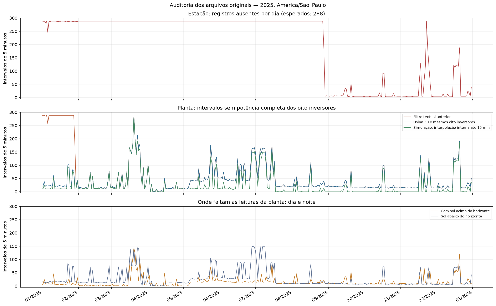
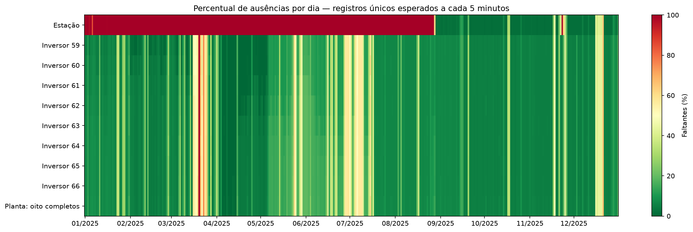

# Auditoria da base original e estratégia recomendada

**Implementação da estratégia:** a base final selecionada está em [base_diaria_leopoldo_consecutiva.csv](../data/processed/brasil/base_diaria_leopoldo_consecutiva.csv), com 43 dias consecutivos entre 01/02 e 15/03/2025. O [relatório do processamento](base_consecutiva.md) documenta os critérios, os demais blocos e o gráfico do resultado.

**Uso dos demais blocos no transfer learning:** o [respaldo bibliográfico e protocolo temporal](respaldo_blocos_temporais.md) explica como aproveitar os 297 dias em 39 segmentos sem criar continuidade falsa. Para histórico de três dias e previsão de um dia, existem 193 janelas completas antes da divisão em treino, validação e teste.

Auditoria de 24/10/2026. Os resultados abaixo vêm diretamente dos dois CSVs originais, antes da imputação diária. Os arquivos originais e as bases de modelagem anteriores foram preservados. Esta análise compara alternativas; não substitui automaticamente a base usada nos experimentos anteriores.

## Conclusão

É melhor recuperar primeiro as observações descartadas pelo filtro, tratar pequenas falhas na resolução de cinco minutos e só depois agregar por dia. Para meteorologia, o grande período sem estação requer uma fonte externa. Interpolação ou KNN apenas entre dias locais não tem validação suficiente para reconstruir os meses sem medição.

Ter um valor diário não garante cobertura adequada: um dia com apenas uma leitura também produz uma média no `resample`. A quantidade e o horário das observações devem acompanhar cada alvo diário.

## Como os faltantes foram contados

### Gráficos da auditoria

O primeiro gráfico mostra quantos intervalos faltam em cada dia, o efeito do filtro dos inversores e a simulação de interpolação curta.



O mapa abaixo mostra a porcentagem de faltantes por dia e por equipamento. Verde indica menos ausências; vermelho, mais ausências.



- Calendário civil completo de 2025, com 365 dias, no fuso `America/Sao_Paulo`. A base anterior tinha 363 dias, a partir de 3 de janeiro; os denominadores são diferentes.
- Esperados por dia: **288 registros da estação** e **2.304 leituras de potência dos inversores** (288 × 8). A planta tem 288 intervalos, cada um exigindo potência válida dos oito inversores.
- Datas originais interpretadas em UTC, convertidas ao horário local e alinhadas pelo início do intervalo de cinco minutos.
- Duplicatas por equipamento/intervalo resolvidas pela maior completude; em empate, pela data mais recente. Não são somadas como medições independentes.
- Separação entre registros ausentes, campos vazios dentro dos registros existentes e intervalos com apenas parte dos inversores. Potência zero observada é preservada.
- Cobertura diurna calculada com elevação solar aparente acima de zero, pelas coordenadas e altitude da usina. O último dia local tem algumas horas noturnas fora do recorte UTC do arquivo; isso entra na contagem de cobertura, sem ser tratado como prova de falha do equipamento.

O resumo com uma linha para **cada dia** está em [resumo_por_dia.csv](../reports/auditoria/resumo_por_dia.csv). O detalhamento está em [faltantes_por_dia.csv](../reports/auditoria/faltantes_por_dia.csv), [faltantes_por_inversor_dia.csv](../reports/auditoria/faltantes_por_inversor_dia.csv) e [faltantes_por_variavel_dia.csv](../reports/auditoria/faltantes_por_variavel_dia.csv).

## Uma parte das ausências era causada pelo filtro anterior

O arquivo dos inversores tem 793.607 linhas. Todos os registros pertencem a `meta.id_usina=50`. Os mesmos oito IDs (59 a 66), cada qual com o mesmo número de série não nulo ao longo do arquivo, aparecem sob os códigos `07-07FX` e `07-07TK-2`. As correspondências estão em [identidades_e_codigos.csv](../reports/auditoria/identidades_e_codigos.csv).

O filtro anterior exigia `usine_code=07-07FX` e descartava registros de janeiro desses mesmos equipamentos. A evidência de IDs e números de série favorece considerá-los uma única identidade na auditoria; o código textual, isoladamente, não é uma chave confiável neste arquivo.

| Comparação no calendário completo de 2025 | Resultado |
| --- | ---: |
| Dias sem nenhum intervalo com os oito inversores válidos, filtro anterior | 27 |
| Dias sem nenhum intervalo com os oito inversores válidos, por identidade | 1 |
| Dias recuperados com observações reais | 26 |
| Intervalos completos de cinco minutos recuperados | 7.236 |

O único dia sem nenhum intervalo completo no cenário por identidade é **20/03/2025**. Isso não significa que os outros 364 dias estejam completos: muitos ainda têm cobertura parcial.

## Estação meteorológica: ausência de timestamps, não de células

A estação tem 35.535 linhas. Os seis campos meteorológicos utilizados não têm valores vazios nas linhas presentes, mas faltam muitos horários. Em janeiro existem somente **62 intervalos únicos de cinco minutos**, apesar de várias linhas duplicadas. Assim, as médias meteorológicas de janeiro não representam dias completos.

Há **225 dias sem nenhum registro da estação**, dos quais **208 consecutivos entre 01/02 e 27/08/2025**, inclusive. Distribuição da cobertura de 24 horas:

| Registros presentes por dia | Dias |
| --- | ---: |
| 0 | 225 |
| 1–143 | 18 |
| 144–229 | 12 |
| 230–273 | 10 |
| 274–288 | 100 |

Interpolar blocos internos inteiros de até três amostras ausentes (15 minutos de amostras faltantes) recuperaria apenas **597 intervalos da estação**. Esse procedimento não resolve o período semestral. Não houve validação específica da interpolação dos seis campos meteorológicos nesta auditoria; esse número mede possibilidade de preenchimento, não acurácia.

## Inversores: tratar antes da média diária

No cenário por identidade faltam **15.097 intervalos completos da planta**, de 105.120 esperados: 5.407 diurnos e 9.690 noturnos. Aproximadamente **64,2%** das ausências da planta ocorrem à noite. O CSV bruto também contém 14.740 potências vazias; a contagem alinhada distingue esses campos das leituras inteiramente ausentes.

A simulação de interpolação temporal por inversor, limitada a blocos internos inteiros de até 15 minutos, recupera **5.353 intervalos completos da planta**. Não extrapola as bordas do dia, não cruza meia-noite e não preenche parcialmente um bloco longo. O número de dias com ao menos 95% de cobertura diurna passa de **118 para 298**; com 90%, de **241 para 314**. Isso é cobertura após estimação, não observações novas nem certificado de qualidade.

### Validação com valores conhecidos ocultados

Foram ocultados blocos de um inversor por vez em trechos diurnos onde os oito estavam medidos. Compararam-se dois métodos nos mesmos casos: interpolação linear entre os extremos e estimativa pela soma contemporânea dos outros sete, escalada pela mediana histórica da razão entre o equipamento e os demais. A razão usa somente os 30 dias anteriores ao bloco, com pelo menos 100 doadores em geração. Semente 42, até 15 casos por mês e tamanho de bloco.

| Lacuna de amostras | Casos | RMSE linear, kW por inversor | RMSE pelos outros sete, kW por inversor |
| --- | ---: | ---: | ---: |
| 5 min | 180 | 15,73 | 6,73 |
| 10 min | 179 | 20,62 | 5,72 |
| 15 min | 179 | 19,67 | 7,66 |

Os erros se referem ao inversor individual de 125 kW, e não a uma normalização pela planta de 1.000 kW. O proxy dos demais inversores foi melhor neste teste. É a opção mais promissora quando apenas um inversor está ausente e os outros sete são válidos e comparáveis. O resultado não valida falhas simultâneas dos oito inversores, meses sem estação ou estimativa de um dia inteiro. Os blocos podem se sobrepor; as métricas são descritivas e não fornecem intervalos de confiança independentes.

As 1.075 amostras ocultadas por método estão em [validacao_lacunas_curtas_detalhada.csv](../reports/auditoria/validacao_lacunas_curtas_detalhada.csv); as métricas, em [validacao_lacunas_curtas.csv](../reports/auditoria/validacao_lacunas_curtas.csv). A validação não depende de dados meteorológicos imputados. Interpolação usa o ponto posterior à lacuna e é adequada à reconstrução retrospectiva; na avaliação de previsão, nenhum dado posterior ao instante da previsão pode ser usado.

## Alternativa para o alvo diário: energia dos contadores

A média das amostras presentes pode ficar inflada quando faltam sobretudo leituras noturnas de potência zero. Em **31/12/2025**, por exemplo, a média das amostras completas é **269,11 kW**, enquanto a diferença dos contadores acumulados dos oito inversores resulta em **5.665 kWh**, equivalente a **236,04 kW** ao longo de 24 horas. A diferença é de aproximadamente **14%**. Isso ilustra o problema; não prova que o contador seja sempre a referência correta.

Foi criada uma alternativa exploratória por diferença do contador acumulado antes/depois do período de luz civil. Exige os oito inversores, leituras de fronteira a até uma hora do início/fim, valores positivos e ausência de queda observada intradiária maior que 2 kWh. São **309 dias candidatos**; não recupera 20 de março. Há zeros suspeitos nos contadores, portanto é necessário validar resets, resolução, unidade e coerência com a integral da potência antes de adotar essa alternativa como alvo definitivo. Consulte [alternativa_energia_por_contadores.csv](../reports/auditoria/alternativa_energia_por_contadores.csv).

Energia diária, média de potência em 24 horas e média somente das amostras presentes são grandezas distintas. Se o alvo passar a energia diária, é necessário definir o mesmo alvo e as unidades na Austrália. O contador acumulado de vida útil não deve ser tratado como energia produzida no próprio dia.

## Estratégia recomendada para os experimentos

1. **Recuperar as observações por identidade** e manter o código textual como metadado de auditoria. Isso resolve boa parte do problema de janeiro sem imputação.
2. **Tratar os cinco minutos antes da agregação.** Priorizar o proxy dos sete inversores para falhas isoladas, com controle de falhas e potência nominal. Para lacunas temporais muito curtas, considerar linear como alternativa e registrar o método. Preservar zeros reais e não preencher automaticamente falhas operacionais.
3. **Separar dia e noite.** Usar posição solar para estudar o preenchimento físico de zeros em períodos seguramente escuros, verificando antes ausência de geração noturna e comportamento da aquisição. Não substituir automaticamente as transições de amanhecer/anoitecer por zero.
4. **Meteorologia anual homogênea de fonte externa** (ERA5 já disponível no projeto), identificada como reanálise. Comparar e validar com o período local confiável. A discrepância já detectada de escala de GHI e a direção de vento constante impedem adotar toda a estação como verdade de referência sem controle adicional. Para lacunas extensas, não copiar dias próximos nem extrapolar a interpolação por meses.
5. **Selecionar dias pela cobertura e qualidade do alvo.** Comparar limiares de 90%, 95% e 99% de cobertura diurna, apresentando a sensibilidade. São decisões operacionais desta análise, não normas universais. Não avaliar a previsão contra um alvo totalmente imputado em 20 de março; manter esse dia como ausente ou fora da avaliação supervisionada.
6. **Comparar dois experimentos:** meteorologia externa homogênea com potência local de qualidade, e um subconjunto com ambas as fontes locais de qualidade. Exigir simultaneamente 95% diurnos na estação e na planta dá apenas **25 dias brutos**, ou **98 dias após a simulação de interpolação curta**; por isso, esse subconjunto serve melhor como análise complementar. O ganho de cobertura não dispensa a validação das estimativas.
7. **Divisão cronológica de treino/validação/teste**, ajuste dos imputadores apenas no treino e indicadores de origem e fração imputada por variável/dia. Usar somente informações disponíveis no horizonte de previsão pretendido. A disponibilidade retrospectiva de ERA5 não equivale à disponibilidade em tempo real.

## Respaldo e limites

A recomendação de controlar qualidade antes de reconstruir séries fotovoltaicas está alinhada com [Livera et al. (2021)](https://www.sandia.gov/research/publications/details/data-processing-and-quality-verification-for-improved-photovoltaic-performa-2021-02-01/). Seus resultados tratam de análise de desempenho e confiabilidade; seus limiares não foram usados aqui como regras universais de previsão.

[Koubli et al. (2016)](https://doi.org/10.1049/iet-rpg.2015.0355) validam reconstrução fotovoltaica com informação ambiental e modelo elétrico, ocultando dados conhecidos. Isso dá respaldo à estratégia de validar a reconstrução, não transfere a precisão publicada para esta usina. O teste dos outros sete inversores acima é evidência empírica específica desta base e ainda deve ser ampliado conforme os tipos reais de falha.

**Critério de decisão:** minimizar erro e viés com rastreabilidade, não chegar artificialmente a 0% de faltantes.

## Reprodução

Na raiz do projeto:

```powershell
.\.venv\Scripts\python.exe scripts\executar_fluxo.py auditoria
.\.venv\Scripts\python.exe -m unittest discover -s tests
```

O notebook `notebooks/02_brasil_auditoria_original.ipynb` apresenta a auditoria em uma etapa própria, com tabelas e os dois gráficos. A coluna `planta_intervalos_recuperaveis_linear15` indica potencial de preenchimento retrospectivo, enquanto `intervalos_recuperados_por_identidade` indica observações reais recuperadas pelo critério de identificação.
