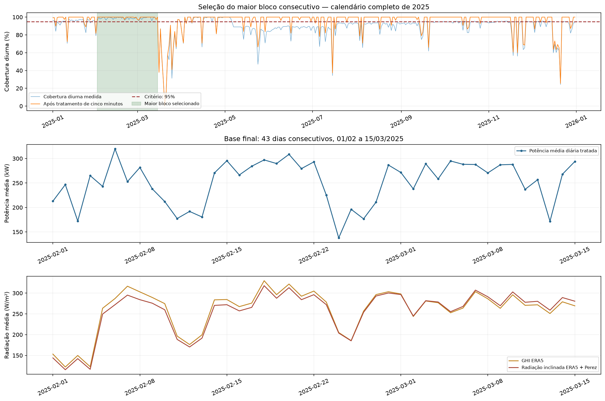

# Base diária consecutiva recomendada

**Período selecionado: 2025-02-01 a 2025-03-15, 43 dias consecutivos, sem datas ausentes ou valores nulos nas 13 colunas.**

Arquivo principal: [base_diaria_leopoldo_consecutiva.csv](../data/processed/brasil/base_diaria_leopoldo_consecutiva.csv). A ordem das colunas é a da Austrália. Os CSVs antigos são resultados de procedimentos anteriores; a saída recomendada deste processamento é este novo arquivo.

## Critério de seleção

Cobertura da potência completa dos oito inversores de pelo menos 95% tanto no período diurno quanto nas 24 horas, após tratamento; todas as variáveis diárias finitas; pelo menos um intervalo completo originalmente medido. Dias reprovados e datas ausentes interrompem a sequência. Empates no comprimento são resolvidos pelo início mais antigo.

No ano, 297 dias passaram pelo critério, distribuídos em 39 blocos. [blocos_consecutivos_leopoldo.csv](../reports/base_final/blocos_consecutivos_leopoldo.csv) lista todos os períodos. [base_diaria_leopoldo_dias_validos.csv](../data/processed/brasil/base_diaria_leopoldo_dias_validos.csv) contém todos os dias aprovados, mas **tem saltos de datas**: não concatenar esses blocos como se fossem uma sequência contínua.

**Sem faltantes significa que não faltam dias nem células na base diária selecionada. Não significa que todos os 288 horários de cada dia foram medidos ou preenchidos.** Os intervalos residuais permanecem ausentes; a média diária usa somente os válidos, com o controle de cobertura acima. Não se interpolam dias inteiros para alongar o período.

## Processamento

1. Seleção da usina 50 pelos oito IDs e números de série, incluindo os dois códigos textuais auditados; deduplicação por equipamento e cinco minutos.
2. Potência: preservação dos observados, inclusive zero. Lacunas internas de até três amostras (15 minutos) são estimadas pelos outros sete inversores quando disponíveis e sem falha sinalizada; razão histórica calculada somente em observações nos 30 dias anteriores, com pelo menos 100 doadores. Não há doadores imputados. Estimativas fora de 0–131,25 kW por inversor são rejeitadas (125 kW nominais + tolerância operacional de 5%).
3. Interpolação linear de blocos originais internos de até três amostras como alternativa, com extremos medidos no mesmo dia. Não estima pontos com falha explicitamente sinalizada. Os demais faltantes noturnos recebem zero apenas com elevação solar aparente abaixo de −6°, após conferir que as leituras noturnas não exibem geração significativa. Amanhecer e anoitecer não recebem zero automaticamente. Leituras observadas não são substituídas.
4. Corrente e contador acumulado: somente interpolação curta, sem aplicar o proxy validado para potência. Zeros de contador acumulado de uma instalação madura são marcados como suspeitos e desconsiderados antes dessa interpolação. Contagens válidas por variável são registradas.
5. Meteorologia exclusivamente ERA5, com cache e SHA-256 verificados; POA pelo modelo Perez, inclinação de 20°, norte e albedo 0,3 conforme hipótese autorizada. Sem mistura de escala com a estação. O cache começa em 02/01: 01/01 é excluído, sem extrapolação meteorológica.
6. Soma dos oito inversores por intervalo e média diária das amostras completas; seleção pelo critério e pelo maior bloco. A chuva conserva a média diária do acumulador para compatibilidade com a definição anterior, e não o total de chuva do dia. A direção do vento usa média circular.

## Qualidade e rastreabilidade

Menor cobertura diurna selecionada: 96.62%. Menor cobertura nas 24 horas: 97.92%. Maior parcela de intervalos diurnos completos com alguma estimativa: 4.08%.

[qualidade_diaria_base_consecutiva.csv](../reports/base_final/qualidade_diaria_base_consecutiva.csv) contém o ano inteiro, cobertura original/tratada, contagens por método, bloco, seleção e motivos de reprovação. [imputacoes_potencia_5min.csv.gz](../reports/base_final/imputacoes_potencia_5min.csv.gz) registra cada potência efetivamente preenchida, por horário, inversor e método. Fontes, hashes, parâmetros e limitações estão em [resumo_base_consecutiva.json](../reports/base_final/resumo_base_consecutiva.json).

## Sensibilidade aos limiares

| Cobertura mínima diurna e 24h | Dias aprovados no ano | Maior bloco | Início | Fim |
| --- | ---: | ---: | --- | --- |
| 90% | 313 | 43 | 2025-02-01 | 2025-03-15 |
| 95% | 297 | 43 | 2025-02-01 | 2025-03-15 |
| 99% | 255 | 23 | 2025-09-21 | 2025-10-13 |

Os limiares são decisões operacionais para comparação, não normas universais. Não foram relaxados para obter um período maior.

## Uso na previsão

O alvo continua sendo **Active_Power em kW médios**, não energia diária em kWh. A coluna Active_Energy_Delivered_Received continua sendo média de contador acumulado de vida útil. Não usar esse contador ou a corrente contemporânea como preditores do mesmo alvo sem verificar vazamento. A auditoria da definição do alvo australiano continua necessária: esquema igual não basta para garantir comparabilidade física.

Este arquivo é uma reconstrução retrospectiva para pesquisa. A interpolação usa o extremo posterior: ao dividir treino e teste, refazer o tratamento por partição, sem atravessar as fronteiras. A razão histórica dos inversores já usa somente o passado. A avaliação principal deve usar alvos medidos de boa cobertura, registrando a fração reconstruída. ERA5 histórica não equivale a uma previsão meteorológica disponível no instante de emissão. O tamanho do bloco não garante dados suficientes para treinar um modelo; os demais blocos podem ser usados em experimentos separados com janelas respeitando as datas.

## Visualização



## Reprodução

```powershell
.\.venv\Scripts\python.exe scripts\executar_fluxo.py base-final
```
