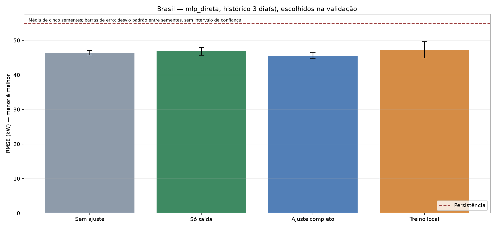
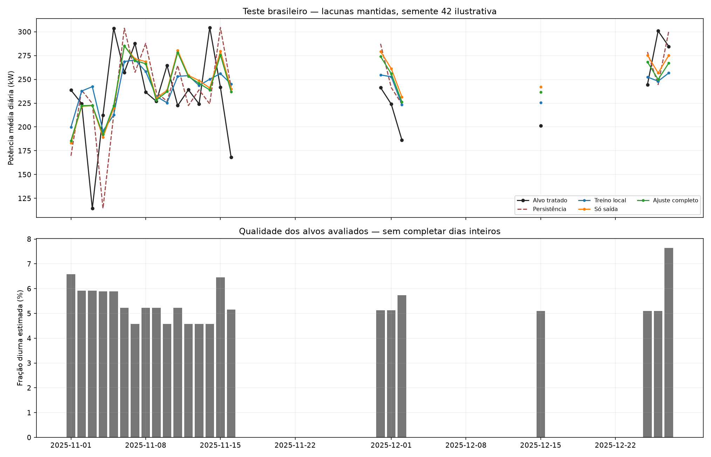

# Transferência Austrália → Brasil — resultado

Escolha pela validação: **mlp_direta**, lag **3**, método **completo**.
A seleção considera médias de cinco sementes. O teste não muda a escolha; persistência pode ser a melhor opção operacional.

A rede escolhida teve redução de 3.67% no RMSE médio frente ao controle local da mesma arquitetura e lag. Valores negativos significam transferência pior que esse controle.
R² médio dessa rede no teste: -0.080. R² negativo indica erro quadrático maior que a referência descritiva da média dos alvos do próprio teste; essa média não é uma previsão disponível antecipadamente.
Não se troca a escolha por outra configuração que apareça melhor no teste. Ganho frente à persistência não demonstra por si só grande capacidade de generalização.

| Arquitetura | Lag | Método | MAE médio (kW) | RMSE médio (kW) | DP RMSE entre sementes | R² médio | Skill persistência (%) |
|---|---:|---|---:|---:|---:|---:|---:|
| lstm_direta | 1 | cabeca | 37.794 | 45.441 | 0.383 | -0.074 | 17.13 |
| lstm_direta | 1 | completo | 36.632 | 44.568 | 0.355 | -0.033 | 18.72 |
| lstm_direta | 1 | local | 32.120 | 44.022 | 0.935 | -0.009 | 19.72 |
| lstm_direta | 1 | sem_ajuste | 37.488 | 45.680 | 0.262 | -0.086 | 16.69 |
| lstm_direta | 3 | cabeca | 40.658 | 48.694 | 0.639 | -0.234 | 11.20 |
| lstm_direta | 3 | completo | 39.935 | 47.655 | 0.969 | -0.182 | 13.09 |
| lstm_direta | 3 | local | 37.178 | 47.001 | 0.469 | -0.149 | 14.29 |
| lstm_direta | 3 | sem_ajuste | 40.577 | 48.544 | 1.707 | -0.227 | 11.47 |
| mlp_direta | 1 | cabeca | 35.251 | 43.987 | 1.573 | -0.008 | 19.78 |
| mlp_direta | 1 | completo | 34.201 | 43.605 | 1.271 | 0.010 | 20.48 |
| mlp_direta | 1 | local | 33.165 | 44.637 | 1.807 | -0.038 | 18.60 |
| mlp_direta | 1 | sem_ajuste | 35.816 | 45.135 | 0.743 | -0.060 | 17.69 |
| mlp_direta | 3 | cabeca | 39.230 | 46.801 | 1.129 | -0.140 | 14.65 |
| mlp_direta | 3 | completo | 37.968 | 45.552 | 0.869 | -0.080 | 16.93 |
| mlp_direta | 3 | local | 36.344 | 47.288 | 2.372 | -0.166 | 13.76 |
| mlp_direta | 3 | sem_ajuste | 38.876 | 46.405 | 0.653 | -0.120 | 15.37 |
| mlp_residual | 1 | cabeca | 36.253 | 44.801 | 1.905 | -0.046 | 18.30 |
| mlp_residual | 1 | completo | 35.428 | 44.238 | 1.747 | -0.019 | 19.32 |
| mlp_residual | 1 | local | 36.099 | 45.387 | 1.538 | -0.073 | 17.23 |
| mlp_residual | 1 | sem_ajuste | 36.160 | 44.709 | 1.674 | -0.041 | 18.47 |
| mlp_residual | 3 | cabeca | 40.210 | 47.023 | 2.838 | -0.154 | 14.25 |
| mlp_residual | 3 | completo | 39.064 | 46.175 | 2.147 | -0.111 | 15.79 |
| mlp_residual | 3 | local | 37.532 | 47.035 | 1.341 | -0.152 | 14.22 |
| mlp_residual | 3 | sem_ajuste | 40.244 | 47.060 | 2.971 | -0.156 | 14.18 |
| persistencia | 0 | persistencia | 46.756 | 54.834 | nan | -0.564 | 0.00 |

Teste: 23 alvos de 2025-11-01 a 2025-12-27, iguais para todos os métodos e lags.
Fração diurna estimada média: 5.41%; máxima: 7.64%.

## Limitações

- Experimento retrospectivo diário. ERA5 histórica não representa informação meteorológica operacional disponível em tempo real.
- Um ano e uma usina de destino; poucos alvos, sem alegação de significância estatística
- A variabilidade entre sementes não é intervalo de confiança temporal
- Unidades, capacidade instalada e associação da fonte seguem fontes_e_hipoteses.json
- Médias diárias com cobertura parcial residual; clima de sensores versus reanálise
- Candidatos selecionados em validação pequena; ranking pode ser instável

Treinos locais usam o mesmo contrato de normalização aprendido na fonte; diferem na inicialização dos pesos. Isso isola a transferência de pesos, sem oferecer ao controle um processamento incompatível.
Resultados da média das métricas de redes individuais; não são métricas de um ensemble. Ganho negativo indica pior desempenho que a referência.
