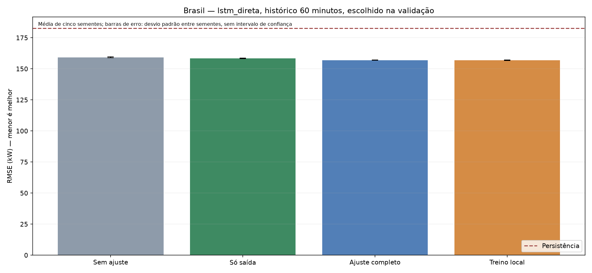
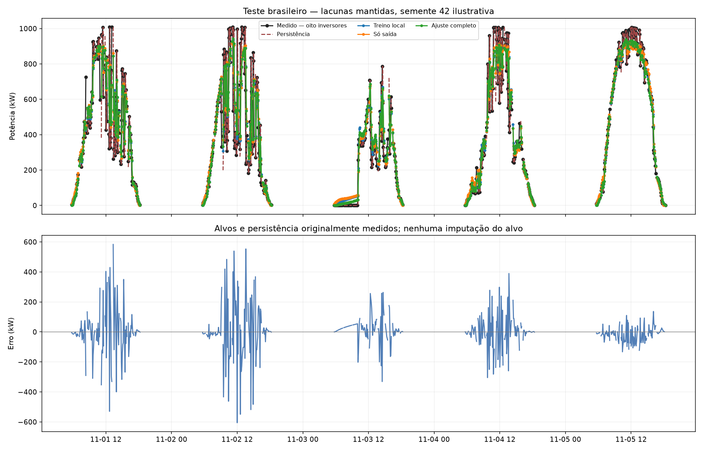

# Transferência Austrália → Brasil — resultado

Escolha pela validação: **lstm_direta**, lag **12**, método **local**.
A seleção considera médias de cinco sementes. O teste não muda a escolha; persistência pode ser a melhor opção operacional.
A validação favoreceu pesos treinados localmente. Não foi demonstrado benefício da transferência neste protocolo.
MAE da persistência: 91.201 kW; MAE da rede escolhida: 93.182 kW. A redução de RMSE não implica melhora em todas as métricas.

A rede escolhida teve redução de 0.00% no RMSE médio frente ao controle local da mesma arquitetura e lag. Valores negativos significam transferência pior que esse controle.
R² médio dessa rede no teste: 0.781. R² negativo indica erro quadrático maior que a referência descritiva da média dos alvos do próprio teste; essa média não é uma previsão disponível antecipadamente.
Não se troca a escolha por outra configuração que apareça melhor no teste. Ganho frente à persistência não demonstra por si só grande capacidade de generalização.

| Arquitetura | Lag | Método | MAE médio (kW) | RMSE médio (kW) | DP RMSE entre sementes | R² médio | Skill persistência (%) |
|---|---:|---|---:|---:|---:|---:|---:|
| lstm_direta | 6 | cabeca | 93.185 | 158.931 | 0.251 | 0.776 | 12.97 |
| lstm_direta | 6 | completo | 93.980 | 157.460 | 0.172 | 0.780 | 13.78 |
| lstm_direta | 6 | local | 93.680 | 157.364 | 0.099 | 0.780 | 13.83 |
| lstm_direta | 6 | sem_ajuste | 94.280 | 160.025 | 0.232 | 0.772 | 12.37 |
| lstm_direta | 12 | cabeca | 93.387 | 158.425 | 0.261 | 0.777 | 13.25 |
| lstm_direta | 12 | completo | 93.055 | 157.029 | 0.151 | 0.781 | 14.01 |
| lstm_direta | 12 | local | 93.182 | 156.969 | 0.206 | 0.781 | 14.05 |
| lstm_direta | 12 | sem_ajuste | 95.584 | 159.318 | 0.321 | 0.774 | 12.76 |
| mlp_direta | 6 | cabeca | 93.209 | 159.537 | 0.295 | 0.774 | 12.64 |
| mlp_direta | 6 | completo | 92.461 | 157.950 | 0.379 | 0.778 | 13.51 |
| mlp_direta | 6 | local | 94.556 | 157.777 | 0.532 | 0.779 | 13.60 |
| mlp_direta | 6 | sem_ajuste | 91.308 | 163.178 | 0.374 | 0.763 | 10.65 |
| mlp_direta | 12 | cabeca | 93.708 | 159.698 | 0.553 | 0.773 | 12.55 |
| mlp_direta | 12 | completo | 92.791 | 157.931 | 0.518 | 0.778 | 13.52 |
| mlp_direta | 12 | local | 95.567 | 157.684 | 0.552 | 0.779 | 13.65 |
| mlp_direta | 12 | sem_ajuste | 92.408 | 162.570 | 0.919 | 0.765 | 10.98 |
| mlp_residual | 6 | cabeca | 93.979 | 161.785 | 1.025 | 0.767 | 11.41 |
| mlp_residual | 6 | completo | 93.547 | 157.807 | 0.253 | 0.779 | 13.59 |
| mlp_residual | 6 | local | 92.894 | 158.008 | 0.463 | 0.778 | 13.48 |
| mlp_residual | 6 | sem_ajuste | 90.337 | 165.805 | 0.649 | 0.756 | 9.21 |
| mlp_residual | 12 | cabeca | 94.113 | 161.902 | 0.801 | 0.767 | 11.35 |
| mlp_residual | 12 | completo | 93.710 | 157.683 | 0.442 | 0.779 | 13.66 |
| mlp_residual | 12 | local | 92.761 | 157.840 | 0.574 | 0.779 | 13.57 |
| mlp_residual | 12 | sem_ajuste | 91.168 | 165.262 | 0.758 | 0.757 | 9.51 |
| persistencia | 0 | persistencia | 91.201 | 182.621 | nan | 0.704 | 0.00 |

Teste: 7668 alvos de 2025-11-01T05:45:00 a 2025-12-31T18:45:00, iguais para todos os métodos e lags.
Fração diurna estimada média: 0.00%; máxima: 0.00%.

## Limitações

- Previsão t+5 minutos; avaliação principal diurna, sem zeros noturnos inflando a métrica.
- Janelas sobrepostas e erros autocorrelacionados; sementes não são intervalos de confiança temporal.
- Dados horários ERA5 apenas auxiliares, fora dos inputs principais.
- Treino fonte usa uma de cada 12 janelas válidas por custo de CPU; validação e teste mantêm todos os alvos elegíveis.
- Capacidades AC instaladas não representam capacidade operacional efetiva diária; falhas e mudanças DKA documentadas.

Avaliação complementar incluindo noite: {'n': 14327, 'RMSE_kw_medio': 119.69793664855996}. Não confundir com o teste diurno principal.

Treinos locais usam o mesmo contrato de normalização aprendido na fonte; diferem na inicialização dos pesos. Isso isola a transferência de pesos, sem oferecer ao controle um processamento incompatível.
Resultados da média das métricas de redes individuais; não são métricas de um ensemble. Ganho negativo indica pior desempenho que a referência.
